# office-worker-claude

A mod for the Claude Code desktop app that puts an animated filing office behind
your conversation. A small, blocky orange Claude works there, and the office
reacts to what your session is doing:

- **As the context window fills,** filing cabinets pop in, in stacks at the
  front where Claude files and in rows lining the far wall behind the desks, the
  weather in the windows turns from a clear night to a storm, the pendant lamps
  swing harder, the clock spins faster, and Claude goes from calmly filing to
  sprinting with its arms in the air.
- **When subagents work** (the Agent tool, workflows, teammates), a small helper
  mascot joins for each one, up to six, each running its own lane.
- **When Claude calls a tool,** it does something different: rummages through a
  pulled-out drawer for reads and searches, types at a desk for edits, looks out
  through binoculars for web tools, and thinks with a bubble at the start of a turn.
  For rummaging and looking out, Claude turns its back to you, so its face is out of sight.

Everything is drawn in one-point perspective. Desks line the far wall, each with
its own mix of paper piles, desk lamps, potted plants, typewriters and printers.
The middle of the window stays clear and a little darker, so the chat reads easily.

## Preview

The whole climb, from an empty context window to a full one:

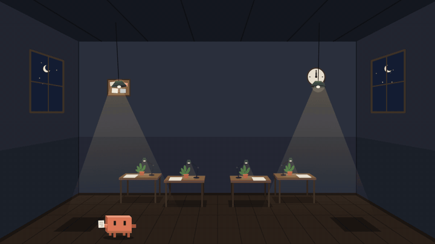

### The six levels

| | |
|---|---|
| **Empty office** (0-15%): one cabinet a side, a clear night, Claude strolling<br>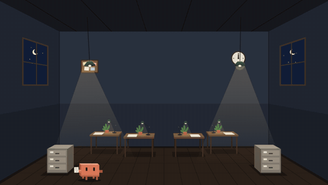 | **Getting busy** (15-35%): clouds roll in, a second cabinet<br>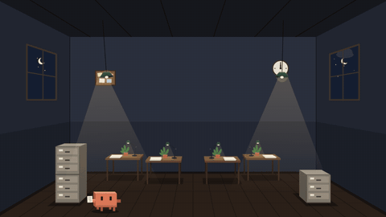 |
| **Busy** (35-55%): drizzle, stacks on both sides, the first flying papers<br>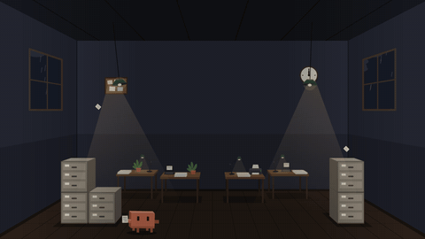 | **Stressed** (55-75%): rain, drawers popping open, worried brows<br>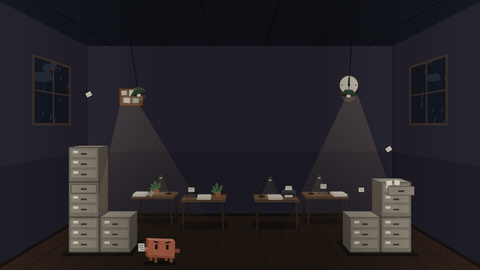 |
| **Panicking** (75-90%): a downpour, sweat, speed lines, crowded sides<br>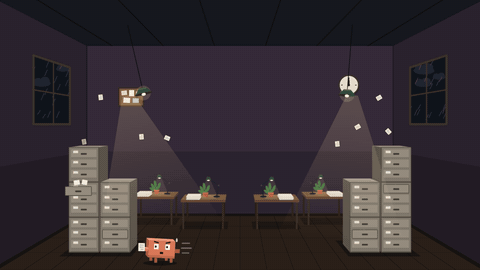 | **Chaos** (90-100%): a storm, the fullest stacks, arms up, lamps swinging wide<br>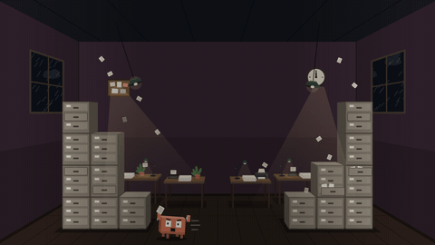 |

### Helpers for subagents

Each subagent at work gets a small helper of its own, up to six. Some run in
front of the stacks, others on the floor behind them:

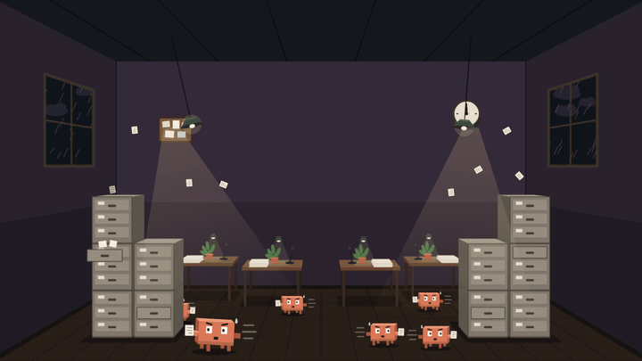

### A pose for each tool

| | |
|---|---|
| **Read, Grep, Glob:** back turned, rummaging in a pulled-out drawer<br>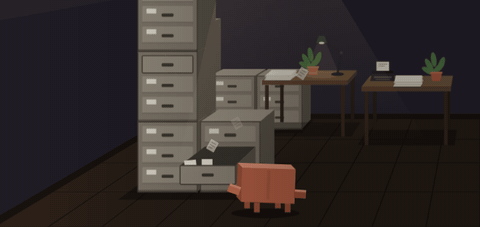 | **Edit, Write:** typing at a desk<br>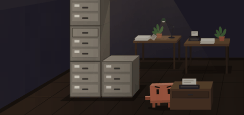 |
| **WebFetch, WebSearch:** back turned, looking out through binoculars<br>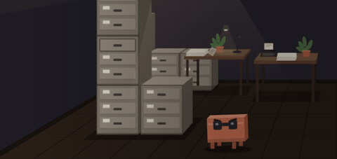 | **Start of a turn:** thinking<br>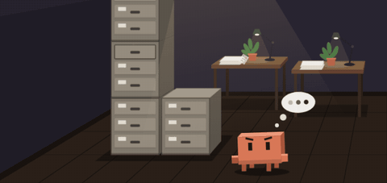 |

These are captured from the mod's own scene code in a browser, so they look the
same as the backdrop in the app, apart from the glass the app lays over it.

## Install

At the prompt of a terminal Claude Code session:

```
/plugin install office-worker-claude --marketplace Yuds16/office-worker-claude
```

Answer `y` to add the marketplace, then pick a scope.

From a shell:

```
claude plugin install office-worker-claude --marketplace Yuds16/office-worker-claude
```

In the desktop app, where `/plugin` does not run: click + next to the prompt box,
then Plugins, Add marketplace with `Yuds16/office-worker-claude`, then Add plugin.

The backdrop shows in the desktop app after the first message of a session. It
needs Claude Code 2.1.324 or later (check with `/status`). A session has one
backdrop, so turn off any other theme mod while this one is on.

## Options

Set these in the plugin's settings (`/config` in a terminal session). A change
takes effect right away.

| Option | Default | What it does |
|---|---|---|
| **Lite mode** (`lite`) | off | Uses less of your computer. Claude and up to two helpers keep moving, but the background holds still: no rain, clouds, stars or lightning, no flying papers or popping drawers, no swinging lamps, clock, plants, typewriters or printers, and no glass blur. |
| **Dim behind the chat** (`dim`) | medium | How much the scene darkens behind the conversation: `light`, `medium` or `strong`. It darkens both the frosted glass and the middle of the scene. |

## The /office command

- `/office` shows the level, the fit, how many helpers are working, lite mode and dim.
- `/office 1` to `/office 6` previews a level; `/office auto` follows the real context again.
- `/office fit <left%> <right%>` fits the room into the part of the window that
  side panels leave uncovered, for example `/office fit 0 35` with a pane open on
  the right. `/office fit` alone goes back to the whole window. The app does not
  tell mods which panels are open, so this is set by hand.
- `/office lite on` or `/office lite off` switches lite mode for this session
  only, whatever the option says.

## Good to know

- Shell tools (Bash, PowerShell) have no pose on purpose: hooking a tool call
  turns off its move to the background and its live output.
- To keep motion gentle, the backdrop changes at most once every five seconds,
  always showing the latest state. With reduced motion turned on, the app shows
  the scene still.
- If the scene is hidden behind the glass, check that Transparency effects is on
  (Windows) or Reduce transparency is off (macOS).

## Customizing

Placement constants (room shape, cabinet stacks, Claude's lane, helper lanes,
desks, lamps, windows) are at the top of `hooks/scene.ts`, with a comment on
each. What stands on each back desk is its `kit` in `BACK_DESKS`, and how dark
each `dim` setting gets is `CENTER_DIM` there (the glass's is `GLASS_OPACITY` in
`hooks/register.tsx`). The level thresholds are in `hooks/levels.ts`, and which tools pick which
pose is `TOOL_ACTIONS` in `hooks/register.tsx`.

## License

MIT
